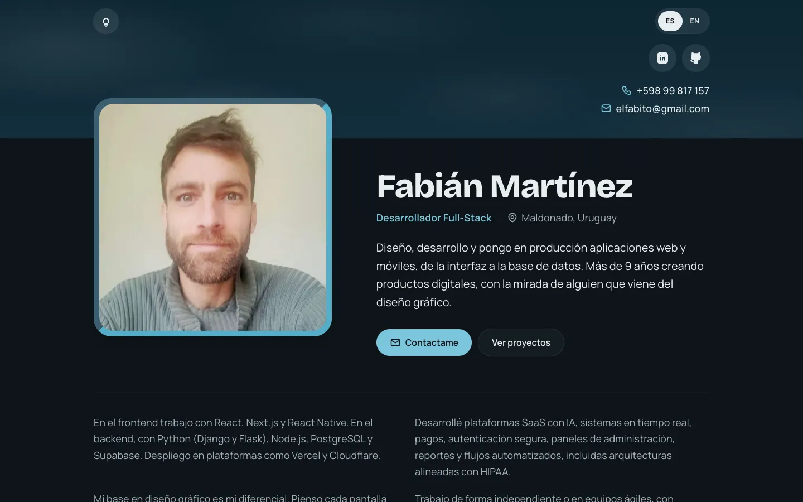

# desane-web

Personal portfolio of Fabián Martínez, Full-Stack Developer: [desane.com.uy](https://desane.com.uy).



## Highlights

- **Static and fast:** built with Astro, no client framework. Images are resized and served as AVIF or WebP at build time.
- **Bilingual:** Spanish at `/`, English at `/en/`. The language switcher keeps you on the same page in the other language.
- **Light and dark themes:** follows the system setting, with a light bulb toggle that remembers the visitor's choice without a flash on load.
- **Works without JavaScript:** scripts only add filters, the image lightbox, video players and the theme toggle on top of plain HTML.
- **Accessible:** keyboard navigation, screen reader labels and respect for reduced motion.
- **Light video embeds:** YouTube thumbnails with a play button; the player loads from youtube-nocookie.com only after a click.

## Stack

[Astro](https://astro.build) 7 · TypeScript (strict) · [Tailwind CSS](https://tailwindcss.com) 4 · Content collections in YAML validated with Zod · [Tabler Icons](https://tabler.io/icons)

## Getting started

Requires Node.js 22.23 or newer.

```bash
npm install
npm run dev      # http://localhost:4321
npm run check    # type check
npm run build    # static site in dist/
npm run preview  # serve the build locally
```

## Editing content

Everything shown on the site lives in `src/content/` as YAML, with each text in both languages (`es` and `en`). Images go in `src/assets/` and are referenced from the YAML with relative paths.

| Path | What it holds |
| --- | --- |
| `src/content/profile.yaml` | Name, contact details, bio, skills and education |
| `src/content/projects/` | Development projects (`featured: true` shows one large on the home page, the rest go under "More projects") |
| `src/content/design-works/` | Design, 3D and animation work shown at `/proyectos` (`featured: true` adds it to the home page, up to four) |
| `src/content/certificates/` | Certificates |
| `src/content/client-sites/` | Client websites, shown as scrollable screenshots (`visible: false` hides one) |
| `src/i18n/ui.ts` | Interface texts in both languages |

The schemas in `src/content.config.ts` check every entry, so a missing field or translation fails the build with a clear message.

## License

© Fabián Martínez. All rights reserved. Client names, logos and screenshots belong to their respective owners.
